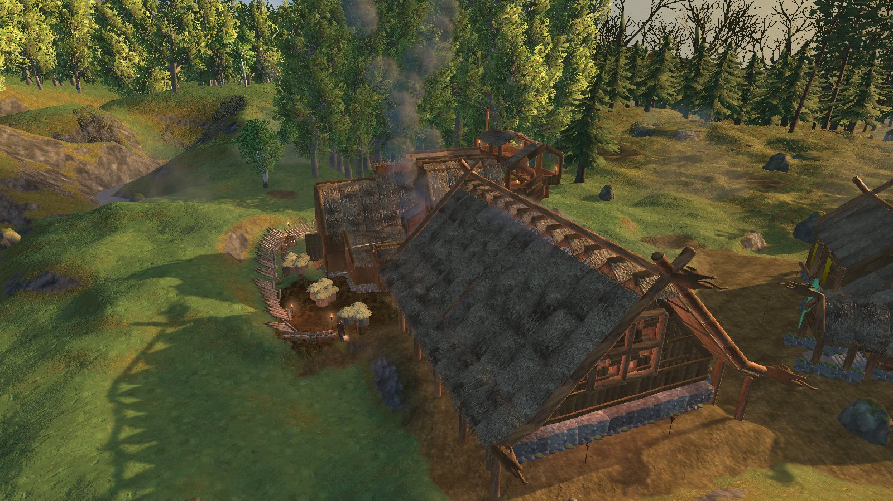
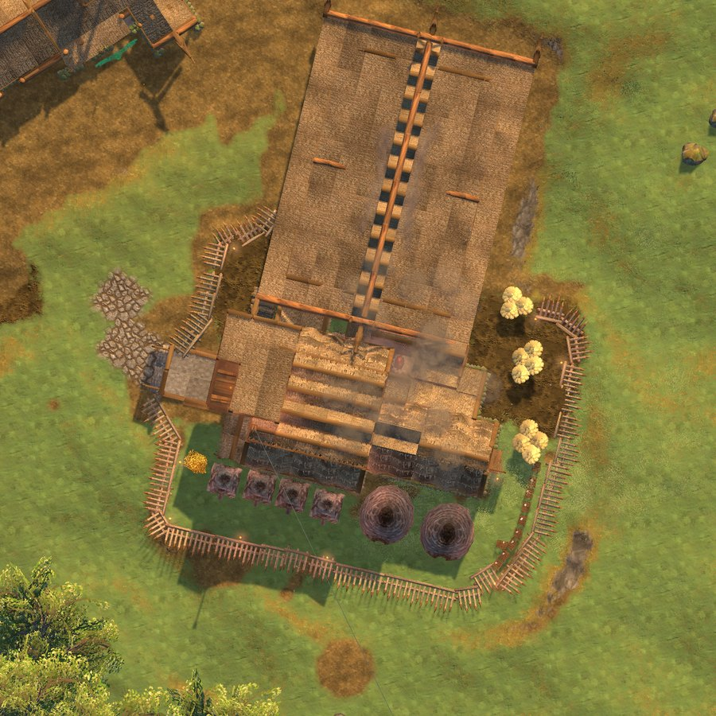

# 🤖 Claude Tools for Valheim


**Everything you need to build good Valheim mods with an AI assistant like [Claude Code](https://claude.com/claude-code): skills that
teach it the game, the game's real code instead of guesses, a pre-release check, clash reports against the 100 most popular mods,
templates and a ready-to-build project, and an in-game mod that lets the assistant see, test and photograph your game while you play.**


[Download the mod](dist/)  ·  [Skills](skills/)  ·  [Templates](templates/)  ·  [Report a bug](https://github.com/HardHeadHackerHead/valheim-claude-tools/issues/new?template=bug.yml)  ·  [Discord](https://discord.gg/EwTjQxEZPy)

[](https://discord.gg/EwTjQxEZPy)  [](https://buymeacoffee.com/quadh)

Everything here comes from making [our own Valheim mods](https://github.com/HardHeadHackerHead/valheim-mods) with Claude Code: every
rule in the skills and every check in `modcheck` is a real bug that cost players their items or buildings, or broke someone else's mod.

## 🧰 What's in the box

| | What it is |
|---|---|
| **[skills/](skills/)** | Skills for Claude Code: **valheim-mod-start** (a new mod, the way the best mods are built), **valheim-game-code** (look it up, never guess), **valheim-compat** (other mods), **valheim-look** (windows in the game's own look), **valheim-pitfalls**, **valheim-prerelease**, **valheim-fix-errors**, **valheim-thunderstore** (releasing). |
| **[templates/](templates/)** | Code to copy into a mod: windows in the game's own look (`GameUi.cs`), words in the player's language (`Translations.cs`), settings the server decides, with a check that the server has the mod (`ServerSettings.cs`), costs a server owner can change (`Costs.cs`), taking from chests safely in multiplayer (`ContainerAccess.cs`), build pieces and items that reload while you play (`PieceReload.cs`, `ItemReload.cs`), items, recipes, smelting, drops and trader items registered by name (`Content.cs`), custom skills that survive a session without the mod (`Skill.cs`), status effects (`StatusEffects.cs`), build-menu pictures drawn from the prefab (`Icon.cs`), snap points for pieces (`SnapPoints.cs`), your own list of a component instead of searching the scene, and big jobs a slice per frame (`Registry.cs`). |
| **[templates/project/](templates/project/)** | A whole mod project to start from: game references, shared code, an example mod in three languages, a translation check and `publish.ps1` for the mod manager. |
| **[mods/ClaudeTools/](mods/ClaudeTools/)** | The in-game mod: your assistant's eyes and hands in the game (below). It also carries all of the above and writes it into `BepInEx/claude`. |
| **[modkit](tools/ModKit/)** | The mod-maker commands as a command-line program, for when the game is closed (Windows, Linux, Mac). |
| **[docs/](docs/)** | [getting-started.md](docs/getting-started.md) (the setup and the loop we work in) and [modding-pitfalls.md](docs/modding-pitfalls.md) (the bugs that lost players' items and buildings, and how to avoid them). |
| **[tools/](tools/)** | [modelkit](tools/modelkit/) (3D models offline, in Python) and the blueprint scripts; PatchMap (builds the list of what the top 100 mods patch); the repo's checks (`check_skills.py`, `check_translations.py`). |

## 🛠️ For mod makers

- **The game's real code:** `game find <text>`, `game <Type.Method>`: signatures, who calls a method, who changes a field, which popular
  mods patch it. `gameupdate` says what a game update broke.
- **`modcheck <mod>`**, a pre-release check of your DLL (it never runs it): the mistakes that have lost players' items and buildings or
  broken other mods, each with why and how to fix it.
- **Other mods:** `who <method>` and `clashes` show which installed and popular mods change the same things as yours, most likely
  clashes first. What the top 100 Thunderstore mods patch is built in (facts only, none of their code); `library get <mod>` fetches any
  other mod's code to read, never to copy.
- **Reloading while you play:** a dev loader for `BepInEx/scripts` and `reload <mod>`, which only reloads when that's safe (each mod's
  *reload level*: anywhere, at the main menu, or only by restarting).
- **Testing like a player:** `screen list`, `click`, `type`, `use` and `overlaps` test your windows; `render` draws any piece, item or
  creature with its real materials; `shoot pose` sets up a picture of a placed piece for your mod's page; `language` checks your
  translations; `inventory` and `chests` before and after measure what a mod really took or gave.
- **Testing with nobody at the keyboard:** `play` goes from the main menu straight into a world, `console` runs the game's own console
  commands (cheats only where cheats are allowed), `clear` and `terrain level` make a clean test site, `daytime` holds the time of day
  for pictures, and `skills`, `effects`, `words`, `itemdata` and `craft` check what a mod changed. `logout` and `quit` save first.
- **Stutter:** `lag 20` times every mod's Update methods, coroutines and patches for 20 seconds and reports each slow frame and what ran
  in it (`mod=<Name>` looks inside one mod). `modcheck` warns about scene searches and whole-world searches on a timer.
- **Releasing:** `modkit package` gets a mod ready for Thunderstore and checks everything an upload needs.

## 🎮 For players: an assistant that sees your game

- **Pictures:** what you see, a separate camera anywhere, all round a place, straight down over your base. F12 saves a screenshot for
  the assistant.
- **What's going on:** your health, biome, weather and time; what you carry; what's nearby; what you're looking at; your chests; the
  ground around you (Ctrl+F12); which mods you run, their settings and the log's errors.
- **Help:** a message on your screen, a pin on your map. With [Quad's Build Orders](https://github.com/HardHeadHackerHead/valheim-mods/tree/main/mods/BuildOrders),
  the assistant designs buildings with you and places them as ghosts for you to build.
- **Your mods' problems:** which mods clash and why, what an error in the log means, what makes the game stutter (`lag`).
- **A stuck world:** `tcdoctor` finds and fixes ground changes that never attached to their ground (the work looks undone, and a friend
  joining can loop on the loading screen). `raven dismiss` sends Hugin and Munin away when they keep following you.

**A picture the assistant took with its own camera, over a base**



**Straight down over a place (the `top` command)**



It works through **files on your computer**: the assistant writes a request (a text file of commands) into `BepInEx/claude/requests`,
the game carries it out while you play and writes the answer beside it. No network port, nothing sent anywhere, and nothing at all until
you switch it on.

## 📦 Install

1. Install [BepInEx for Valheim](https://thunderstore.io/c/valheim/p/denikson/BepInExPack_Valheim/).
2. Get the mod, one of two ways:
   - **With our [mod manager](https://github.com/HardHeadHackerHead/valheim-mod-manager):** press **F7** in the game, find Claude Tools
     in **Browse**, click **Install**. It shows you updates.
   - **By hand:** download `ClaudeTools.dll` and `ClaudeTools.pdb` from [dist/](dist/) into `BepInEx/plugins` (or `BepInEx/scripts`).

It isn't on Thunderstore: it downloads other mods' code to read (the mod library) and loads the mods you are making from memory, which
Thunderstore doesn't allow.

### The skills in Claude Code

This repo is a Claude Code plugin. Install it once and the skills are in every session, picked up by themselves when you work on
a Valheim mod:

```
/plugin marketplace add HardHeadHackerHead/valheim-claude-tools
/plugin install valheim-modding@valheim-claude-tools
```

Updates: `/plugin marketplace update valheim-claude-tools`, or switch on auto-update for it under `/plugin` → Marketplaces. (Or copy
[skills/](skills/) into a project's `.claude/skills` by hand.) The templates are plain files: copy what you need from
[templates/](templates/). The mod adds the game-side half: the commands, `modcheck` against the real game, and pictures.

## 🚀 Getting started

**New to this?** [docs/getting-started.md](docs/getting-started.md) is the whole setup, step by step, and the loop we work in.

**Making a mod:**
1. Install the skills (above), and copy [templates/project](templates/project/) (or `BepInEx/claude/templates/project` once the mod
   has run) to where you keep your code.
2. Set `VALHEIM_DIR` to the game folder, start Claude Code there and say what you want to make. The **valheim-mod-start** skill walks
   through the rest.

**Letting the assistant see your game:**
1. Start the game once with the mod, then set **`AllowRequests = true`** in `BepInEx/config/com.quad.claudetools.cfg` (or F7 → Mod
   settings). Only switch it on while you work with an assistant.
2. Start Claude Code in `BepInEx/claude` (the `BepInEx` folder the game uses; with r2modman, Settings → Browse profile folder). It reads
   `CLAUDE.md` there, which lists every command.
3. Load into a world and ask: *"take a picture of my base from above"*, *"why does my game stutter?"*, *"which of my mods clash?"*.

You can type any command yourself too, in the game's console (F5; switch it on in Settings → Gameplay → "Enable console"):
`claude modcheck MyMod`, `claude who Player.ConsumeResources`.

## 🔒 What it can and can't do

- **Off until you say so:** requests run only with `AllowRequests` on; changing other mods' settings needs `AllowConfigChanges` as well.
- **Only files on this computer:** no network port. The only downloads are the mod library (`DownloadMods`, off by default): the top
  mods' DLLs from Thunderstore, kept to be read, never loaded or run, and never shared.
- **Cheats follow the game's rule:** anything that changes the world or acts for you (giving items, growing plants, moving your
  character, removing objects, pressing keys) works only in single player, for the host, or with devcommands on.
- **Nothing is shared** with other players: only the players who want it install it.

## ⚙️ Settings

In `BepInEx/config/com.quad.claudetools.cfg`, made the first time the game runs with the mod (F7 → **Mod settings** with our manager).

| Section | Setting | Default | What it does |
|---|---|---|---|
| Requests | `AllowRequests` | `false` | Carry out request files an AI assistant drops into `BepInEx/claude/requests`. Turn it on while you work with an assistant. |
| Requests | `AllowConfigChanges` | `false` | Also let requests change mods' settings (`config set`). Reading settings is always allowed. |
| Keys | `ScreenshotKey` | `F12` | Save a screenshot (and where you stand and look) for the assistant. |
| Keys | `SurveyKey` | `F12 + LeftControl` | Write the ground heights, water and buildings around where you look into `_survey.json`. |
| Keys | `SurveyRadius` | `24` | How far a survey reaches (metres). |
| Dev | `LoadScripts` | `true` | Load the mods in `BepInEx/scripts` at start, so they can be reloaded one at a time. Ignored when ScriptEngine is installed. |
| Dev | `AutoReload` | `false` | Reload a mod in `BepInEx/scripts` as soon as it is rebuilt, when that is safe. |
| Library | `DownloadMods` | `false` | Keep the most-downloaded mods' DLLs (code only, never run) to see what they patch. |
| Library | `TopMods` | `10` | How many of the most-downloaded mods to keep. |
| Library | `RefreshDays` | `7` | Look for new versions and a new top list after this many days. |
| Library | `AlsoKeep` | | More mods to keep whatever their rank (`Namespace-Name`, separated by commas). |
| Library | `Skip` | mod managers, BepInEx | Packages that are not mods, left out of the top list. |

## 🧩 Other mods

- **ScriptEngine:** if it's installed, it loads the mods in `BepInEx/scripts`, and `reload` still reloads one at a time.
- Mods made with Jotunn or blaxxun's managers are never reloaded while the game runs (they need a restart).
- **Mods add commands to it:** [our Companion, Build Orders, Dungeons, Arena, Guns, Parkour, Blockscript, Jet Skis, Four Wheelers,
  Mountain Bikes, Ledger Chest, Bird Trap, Rainbows, Skål Tavern and Ziplines](https://github.com/HardHeadHackerHead/valheim-mods) do, and Quality of Life's chest assignments are read and set with `chests` and `chestrule`. Yours can too, without depending on Claude
  Tools: see "For mod makers: adding commands" in [the guide](mods/ClaudeTools/CLAUDE.md).

## 🏗️ Building from source

```
skills/                     the Claude Code skills
templates/                  code templates, and project/ (a whole mod to start from)
docs/                       getting started, modding pitfalls
mods/
  Directory.Build.props     game paths and references
  ClaudeTools/              the mod (CLAUDE.md is the assistant's guide it writes to BepInEx/claude)
  Shared/                   compiled into the mod: AI disclosure, settings migration
tools/                      (its README says what each one is)
  ModKit/                   modkit, built and carried inside the mod
  PatchMap/                 makes mods/ClaudeTools/Shipped/patchmap.json.gz from the top 100 Thunderstore mods
  Shared/                   Thunderstore.cs, used by ModKit and PatchMap
  modelkit/, blueprints/    the Python kits the mod writes to BepInEx/claude/modelkit
  check_skills.py           every skill's header is valid (run after changing a skill)
  check_translations.py     every language has the same keys and placeholders as English
  sync_project_template.py  keeps the mod manager repo's template/ the same as templates/project
publish.ps1                 builds and writes dist/ (the feed the mod manager reads)
```

1. Install the [.NET SDK](https://dotnet.microsoft.com/download) (8 or later) and BepInEx in your game.
2. Set `VALHEIM_DIR` to the game folder (Steam's usual places on Linux are found by themselves).
3. `dotnet build mods/ClaudeTools -c Release` builds the mod (and modkit) and copies it into `BepInEx/scripts`; add
   `-p:DeployToGame=false` to only build.
4. `pwsh -File publish.ps1` writes `dist/` for a release; commit and push it.
5. To refresh what the top mods patch: `dotnet run --project tools/PatchMap` (downloads them into `tools/PatchMap/cache`, never
   committed).

## 🤖 Made with AI

Made with the help of Claude (Anthropic), with Claude Code: designed, written and checked together, and tried in the game. Claude Tools
is an independent project, not made or endorsed by Anthropic or Iron Gate.

## 💬 Join us on Discord

<a href="https://discord.gg/EwTjQxEZPy"></a>

Come hang out with the people who make and play these mods. In the **Quads Lab Discord** you can:

- 🛠️ **Get help** and report bugs straight to us
- 👀 **See new mods first**, and help test them before they're released
- 🗳️ **Suggest ideas** and vote on what we make next
- 🏰 **Share your builds**, bases and arena runs
- 🤖 **Talk AI coding and vibe coding** with people building things with AI, the way these mods are made

**[Join the Quads Lab Discord →](https://discord.gg/EwTjQxEZPy)**

## 🧪 About Quads Lab

Quads Lab is where **Quad H** ([HardHeadHackerHead](https://github.com/HardHeadHackerHead)) builds software with AI, of every kind:
these Valheim tools are one of its projects. Each mod is designed by a player, written with [Claude Code](https://claude.com/claude-code)
and tested in our own world, with **bobisme** as our tester.

- 🌐 [quadslab.io](https://quadslab.io)
- 🧰 [Our Valheim mods](https://github.com/HardHeadHackerHead/valheim-mods) and [on Thunderstore](https://thunderstore.io/c/valheim/p/Quads_Lab/)
- 🎛️ [The mod manager](https://github.com/HardHeadHackerHead/valheim-mod-manager)
- 💬 [Discord](https://discord.gg/EwTjQxEZPy)
- ☕ [Buy me a coffee](https://buymeacoffee.com/quadh)
- 🐞 Found a bug? [Open an issue](https://github.com/HardHeadHackerHead/valheim-claude-tools/issues/new/choose)

## ☕ Support my mods

<a href="https://buymeacoffee.com/quadh"></a>

Claude Tools and every Quads Lab mod are free, and they stay that way. If one of them made your game better and you'd like to say thanks, a coffee
helps me make new mods and keep improving the ones you already play. It's 100% optional, and always appreciated!

**[☕ Buy me a coffee →](https://buymeacoffee.com/quadh)**

## 📜 Changes

[CHANGELOG.txt](mods/ClaudeTools/CHANGELOG.txt). The history before 1.2.6, when Claude Tools moved here, is in
[valheim-mods](https://github.com/HardHeadHackerHead/valheim-mods/commits/main/mods/ClaudeTools).

## 📄 License

[MIT](LICENSE)
